# LabMark · 实验视频标注助手

> 保利威校园黑客松（单日极速开发）参赛作品 · 参赛人：Andrea
> 纯前端 / 无需后端 / 无需登录 / 双击即用

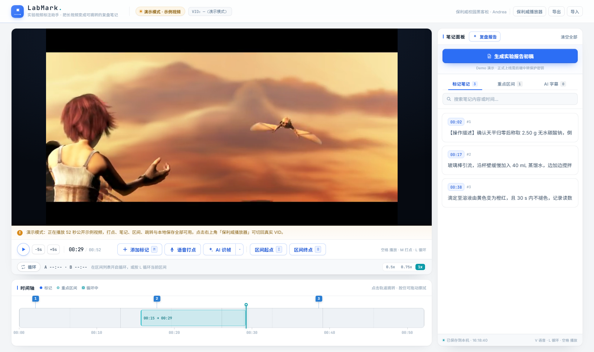

> 上图是真实运行画面：《铝与酸、碱溶液的反应》02:44，5 条打点全部自动带上关键帧缩略图，时间轴下方是 AI 生成的分段字幕轨，右侧正在循环「氢氧化钠与铝片反应」区间。

本版新增三件事：**关键帧缩略图**、**导出 Word / PDF**、**AI 分段字幕**（各章节都有实拍）。再加上此前的 **A-B 循环播放**、**语音打点**、**AI 实验报告初稿**，整条链路已经从「看视频」走到了「交作业」。界面也做了一轮完整重做，见 [十四、界面设计](#十四界面设计)。

---

## 一、项目简介

**LabMark 是专为高校实验教学打造的视频智能复盘工具。**

依托保利威成熟的音视频点播能力，学生可在实验回放视频中精准标记关键操作步骤、记录易错点、保存重点区间，将冗长的实验视频转化为结构化、可跳转、可复盘的学习资源，大幅提升课前预习、课后复盘效率。本项目为单日独立开发作品，轻量化、高适配、完全贴合校园实验场景。

**一句话价值**：实验视频很长，重点只有几十秒 —— 打一个点，就能跳回去；让 AI 把点整理成报告；最后导出一份能直接交给老师的文档。

---

## 二、它解决什么问题

| 现状痛点 | LabMark 的做法 |
| --- | --- |
| 一节实验课录播 40~90 分钟，找「这一步到底怎么操作」要反复拖进度条 | 在关键帧一键打点，时间轴生成彩色小旗帜，点击即跳转 |
| 看视频时的想法记在纸上/备忘录里，回头对不上时间 | 笔记与秒数永久绑定，写在时间戳旁边，随视频走 |
| 考试前只想复看「滴定操作」这一整段，却只能手动记起止时间 | 设置区间起点/终点，生成重点区间色块，整段回看 |
| 打点容易，但写成规范的实验报告很费时间 | AI 读帧自动写【操作描述】+【易错提醒】，一键把全部打点整理成 4 模块复盘报告，或直接生成 6 章实验报告初稿（可下载 .md） |
| 报告生成了，却还是没法交 —— `.md` 手机打不开、Word 不认 | 一键导出 **Word（.doc）** 或打印成 **PDF**，文档里含报告正文 + 关键帧截图 + 打点清单 |
| 笔记只有文字，回头想不起「这一步画面里到底什么样」 | 每次打点自动截一张当前画面，右侧笔记列表变成「缩略图 + 文字」卡片，点开可看大图 |
| 想快速知道「哪个时间段在做什么」，只能靠拖进度条试 | AI 按时间段分析画面，生成分段字幕，铺在时间轴下方，点击即跳到那一段 |
| 戴着手套做实验，根本腾不出手打字 | 「语音打点」说一句，自动落在当前秒数，并让 AI 把口语洗成 ≤30 字的规范笔记 |
| 点火、滴定终点这类关键操作只有两三秒，正常速度看不清 | 圈出 A-B 区间开循环，到终点自动跳回起点，还能配 0.5x / 0.75x 慢放反复看 |
| 换个浏览器、关掉页面，之前的笔记全没了 | 全部数据落 localStorage，刷新、重启浏览器都还在 |

---

## 三、功能清单

| # | 需求 | 实现情况 | 关键代码 |
| --- | --- | --- | --- |
| 1 | 保利威点播播放器接入（播放/暂停/拖拽） | ✅ 官方 CDN SDK 真实实例，`polyvPlayer({wrap, vid})` | `player-adapter.js` → `_initPolyv()` |
| 2 | 实时监听 timeupdate 获取当前时间 | ✅ SDK 事件 + 原生 `<video>` 事件 + 200ms 轮询三层保障 | `_hookSdkEvents()` / `_bindNativeEvents()` / `_startPolling()` |
| 3 | 一键打点，自动记录时间戳 | ✅ 「添加标记」/ `M` 键，取当前播放秒数 | `app.js` → `addMarker()` |
| 4 | 时间轴彩色小旗帜 | ✅ 位置按 `time/duration` 百分比定位，5 种可切换颜色 | `renderTimeline()` |
| 5 | 时间戳笔记绑定 | ✅ 每条标记独立 textarea，输入即保存，秒数永久绑定 | `renderNotes()` + `input` 事件委托 |
| 6 | 标记一键跳转 | ✅ 点旗帜 / 点时间码 / 点笔记，播放器 seek 到对应位置 | `jumpToMarker()` → `player.seek()` |
| 7 | 重点区间标记（加分项） | ✅ 起点 / 终点（`I` / `O`），时间轴渲染为区间色块并显示时长 | `setRangeStart()` / `setRangeEnd()` |
| 8 | 本地持久化 | ✅ 按视频 VID 分键存 localStorage，刷新/重启不丢 | `store.js` |
| 9 | 导出 / 导入 | ✅ 顶部「导出」下拉：**Word / PDF / Markdown** 三份可交付文档 + JSON 备份 + 导入 JSON | `export.js` / `app.js` → `exportWord()` |
| 10 | **AI 识帧打点（模式 A）** | ✅ 截取当前画面 → 自动生成【操作描述】/【易错提醒】笔记 | `ai.js` → `noteFromFrame()` |
| 11 | **AI 复盘报告（模式 B）** | ✅ 读取全部打点 → 4 模块结构化报告，可复制 / 下载 .md | `ai.js` → `report()` |
| 12 | **播放异常自诊断 + 自动重试** | ✅ 识别 `#001~#005` 错误码 → 中文原因 + 建议；`#003` 先自动重试一次（重建播放器、回到原进度），失败再给「重试播放 / 运行诊断 / 切换示例视频」三个出口 | `player-adapter.js` → `_watchSdkError()` / `retry()` / `diagnose()` |
| 13 | **AI 实验报告初稿（6 章）** | ✅ 读取全部打点 → 目的/器材/步骤/注意事项/数据表/思考题，Markdown 排版，一键复制 / 下载 `report.md` | `ai.js` → `reportDraft()` |
| 14 | **语音打点** | ✅ `webkitSpeechRecognition` 收音 → 当前帧落点 → AI 把口语整理成 ≤30 字规范笔记；**识别服务不可达时自动重试一次，并停在提示条上直接「手动输入」**（见 6.4） | `app.js` → `startVoice()` / `voiceFailed()` / `handleVoiceText()` |
| 15 | **A-B 区间循环播放** | ✅ 区间旁「循环」开关，到 B 点自动跳回 A 点，支持 0.5x / 0.75x / 1x 倍速 | `app.js` → `toggleLoop()` / `checkLoop()` |
| 16 | **关键帧缩略图** | ✅ 打点 / 识帧 / 语音打点时自动截取该秒画面，列表变卡片墙，点击看大图；**取帧前先显示「截取中」骨架；视频还没出画面时排队补拍；真截不到给虚线占位，点一下重截**；超量自动按旧到新淘汰 | `app.js` → `grabThumb()` / `paintThumb()` / `ai.js` → `makeGrabber()` |
| 17 | **导出 Word / PDF / Markdown** | ✅ 报告正文 + 关键帧附录 + 打点清单拼成 A4 文档，`.doc` 可直接用 Word/WPS 编辑，PDF 走浏览器打印；**没有 AI 报告也能导出**（正文自动用打点记录兜底） | `export.js` → `buildHTML()` / `toWord()` / `toPDF()`，`app.js` → `exportWord()` / `exportMarkdown()` |
| 18 | **AI 分段字幕** | ✅ 按 20 秒分段抽帧 → 多模态理解画面 → 一句话说明，铺在时间轴下方，可点击跳转 / 可搜索 | `app.js` → `generateSubtitles()` / `ai.js` → `subtitlesForFrames()` |

界面是**冷光实验室**风格：极浅冷灰蓝底 + 纯白卡片 + 克制的靛蓝主色，固定三栏（上播放器 / 下时间轴 / 右笔记），为电脑横屏演示优化。字体、配色与层次的具体做法见 [十四、界面设计](#十四界面设计)。

实拍（全部为真实运行画面）：

| 关键帧缩略图 + 字幕轨 | AI 分段字幕 | 关键帧大图 |
| --- | --- | --- |
| 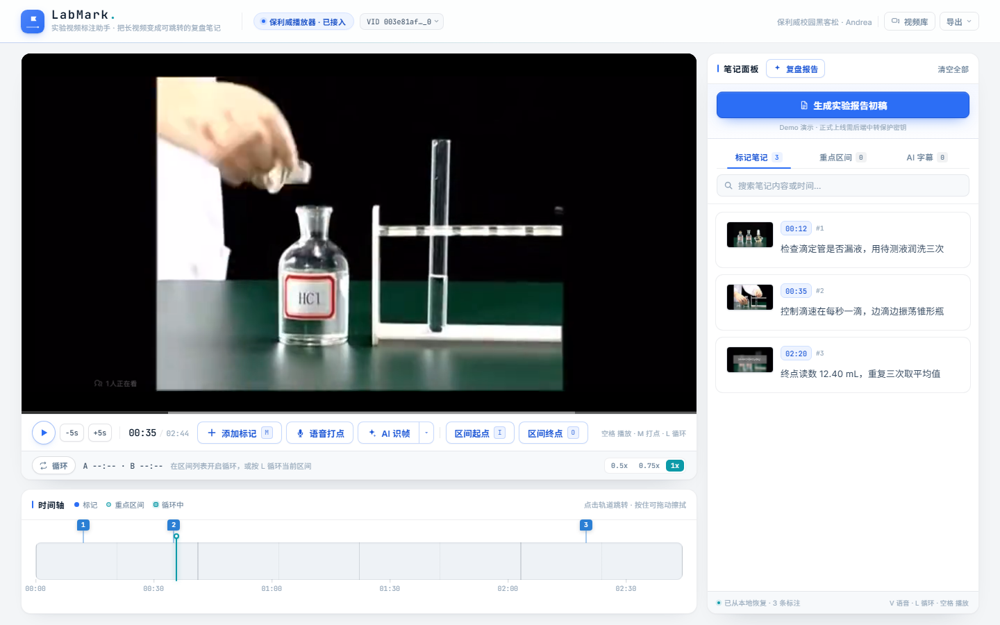 | 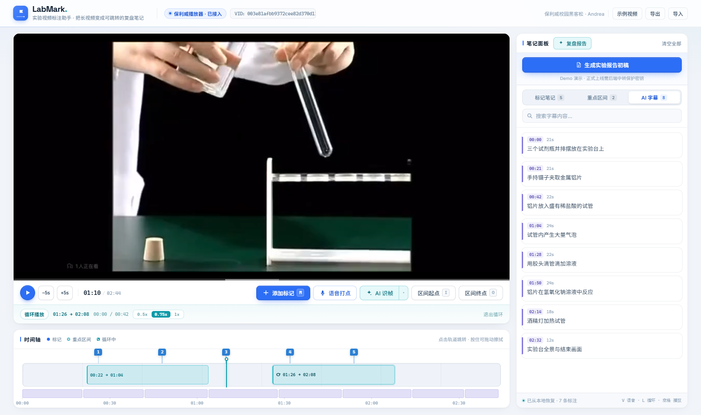 | 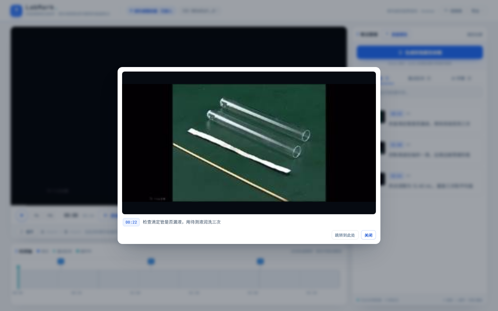 |

| 循环播放 | 语音打点 | 导出 Word / PDF |
| --- | --- | --- |
| 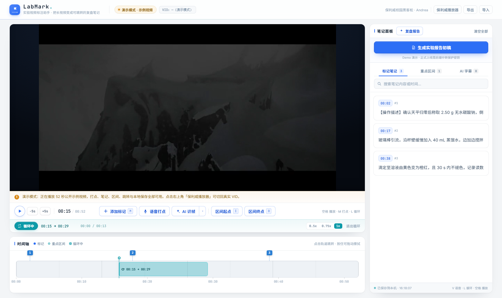 | 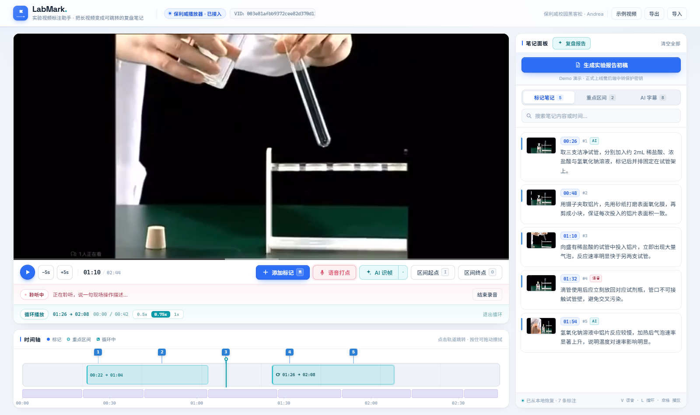 | 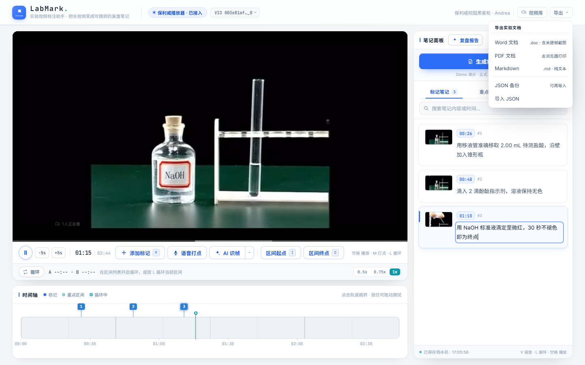 |

| 语音服务不可用 → 手动输入兜底 | 演示模式（断网可用） |
| --- | --- |
| 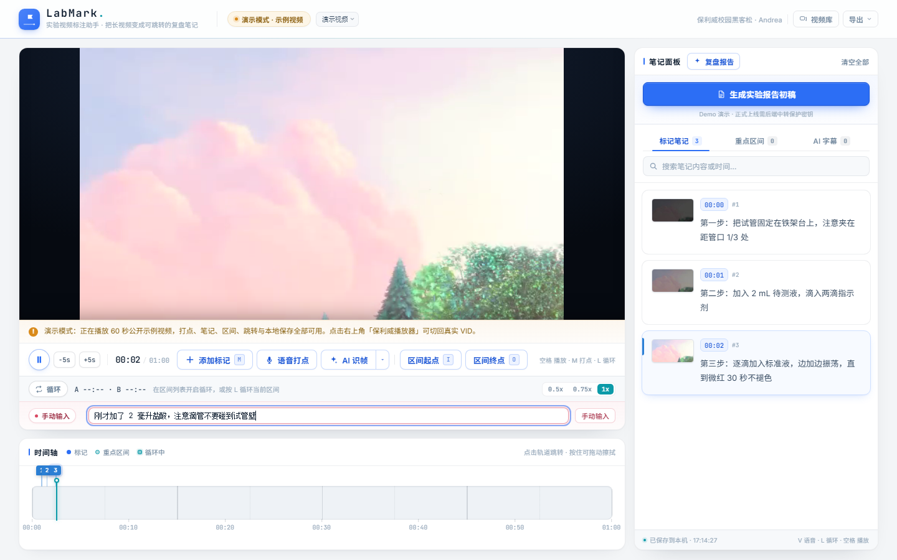 | 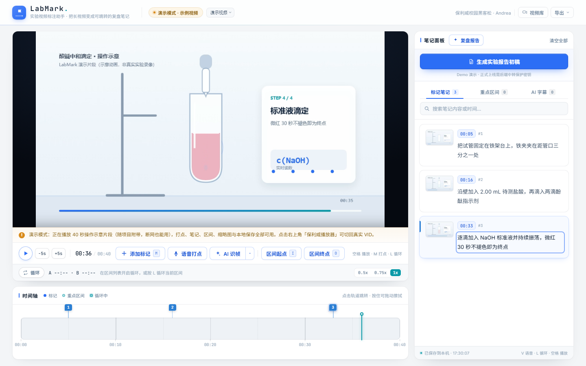 |

---

## 四、快速开始

### 1. 直接双击 `index.html`

默认加载账号里已上传的实验视频：**《铝与酸、碱溶液的反应》**（VID `003e81afbb9372cee82d370d135661b1_0`，02:44，960×448），顶部徽章显示「保利威播放器 · 已接入」。

### 2. 换成别的视频

```text
index.html?vid=你的VID
```

也可以直接改 `assets/js/config.js` 里的 `DEFAULT_VID`。
想看演示效果但手上没有 VID：`index.html?demo=1`（40 秒操作示意片段，走演示模式，断网也能用）。

### 3. 如果浏览器限制了 file:// 下的播放

个别安全策略严格的浏览器建议用本地服务器打开：

```bash
python -m http.server 8000
# 然后访问 http://127.0.0.1:8000/index.html
```

### 4. 播放器报错时怎么办（`Error code: #003` 等）

保利威播放器初始化失败时，会在画面上直接渲染错误面板，例如：

```text
播放器初始化失败
获取播放凭证失败
Error code: #003
```

**这不是本项目的逻辑问题，而是播放器向 `player.polyv.net` 取播放凭证失败。**
LabMark 已经把这类错误接住：画面上方会出现红色提示条，写着错误码的中文含义与对应建议，
右侧三个按钮就是排障入口：

| 动作 | 作用 |
| --- | --- |
| **重试播放** | 销毁并重建播放器（= 重新向保利威要一次凭证），成功后自动回到出错前的进度；#003 大多一次就恢复 |
| **运行诊断** | 直接请求播放器用的凭证接口（`https://player.polyv.net/videojson/{VID}.json`），把「页面来源 / SDK / VID / 接口状态 / 数据大小 / 当前错误码」逐项打出来，并给出结论 |
| **切换示例视频** | 立刻降级到公开示例视频，打点、笔记、区间、报告全部照常可用，演示不中断 |

`#003` 还有一层自动兜底：**第一次失败不打扰用户，先在 1.2 秒后自动重试一次**
（提示条写「正在重新获取播放凭证…（第 1 次重试）」），
重试成功就自动收起提示条、跳回原位，并 toast 一句「已重新取到播放凭证」；
只有自动重试也失败，才亮出上面三个按钮让用户自己决定。
之所以就地重建而不是刷新页面，是因为刷新会丢掉当前进度和还没保存的草稿。

错误码对照（`assets/js/player-adapter.js` 里的 `SDK_ERRORS`，**只收录本项目实测过的码**，
其余码会原样展示播放器自己的那句话，不做无依据的猜测）：

| 错误码 | 播放器原话 | 常见处理 |
| --- | --- | --- |
| `#003` | 获取播放凭证失败 / 视频暂时无法播放，请稍后刷新重试 #003 | **多为瞬时失败**：短时间内刷新太多次被限流、代理缓存了旧凭证、插件拦了播放器发出的那一跳 → 先点「重试播放」；反复失败再查转码状态、播放域名白名单 / 播放密码 |
| `#004` | 当前视频无法播放，请向管理员反馈 | VID 不存在、视频已删除，或当前账号无权播放 |

诊断结果怎么读：

* 接口**请求失败 / 超时** → 本机到保利威的网络不通，检查代理、广告拦截插件、公司网络策略；
* 接口 **200 但数据只有一百多字节**（正常视频是一千字节以上）→ 凭证是空的，问题在视频侧：
  还在转码、已下线，或被安全设置限制；
* 接口 **200、数据也正常，但播放器仍报 `#003`** → 凭证接口本身是通的，失败发生在播放器取凭证那一跳
  （限流 / 代理缓存 / 插件二次拦截）。结论会直接提示「先重试」，不用去后台瞎改设置；
* 接口**返回正常**但画面依旧黑屏 → 媒体流被拦，或被后台播放域名白名单挡住，换浏览器 / 换示例视频先演示。

另外补了两条兜底，保证任何情况下都不会「静悄悄地黑屏」：

1. 轮询容器文本，捕捉播放器自己渲染的 `#xxx` 错误码；
2. 播放器创建后 9 秒仍拿不到视频时长 → 判定视频源不可播，主动给出提示。

> **实测记录（值得记一笔）**：`#003` 最隐蔽的一种成因是**页面本身带 CSP**。
> 用 `Content-Security-Policy: connect-src 'self'` 提供页面时，SDK 能正常加载、播放器 UI 也渲染了，
> 但播放器去 `player.polyv.net/videojson/{VID}.json` 取凭证的 XHR 被浏览器拦掉，
> 控制台只留下一句 `violates the following Content-Security-Policy directive: "connect-src"`，
> 界面上直接就是 `#003`。如果是在带严格 CSP 的内置预览 / 企业门户里打开，改用自己的静态服务器
> （`python -m http.server`）即可，代码无需改动。
>
> **`#003` 的可复现实验**（不必等它自己出现）：用 Playwright / DevTools 把
> `**/videojson/**` 这条请求 abort 掉，等价于「插件拦了取凭证的那一跳」，页面会稳定出现
> `视频暂时无法播放，请稍后刷新重试 #003`。实测链路：930ms 弹「正在自动重试…」→ 2.1s 重建播放器
> → 2.6s 自动重试失败、亮出三个按钮；恢复网络后点「重试播放」，约 1s 取到时长 164.4s、提示条自动收起、
> 打点与关键帧缩略图照常（1 张图 0 失败），控制台零报错。

| 播放失败时的提示条 | 运行诊断的结果 |
| --- | --- |
| 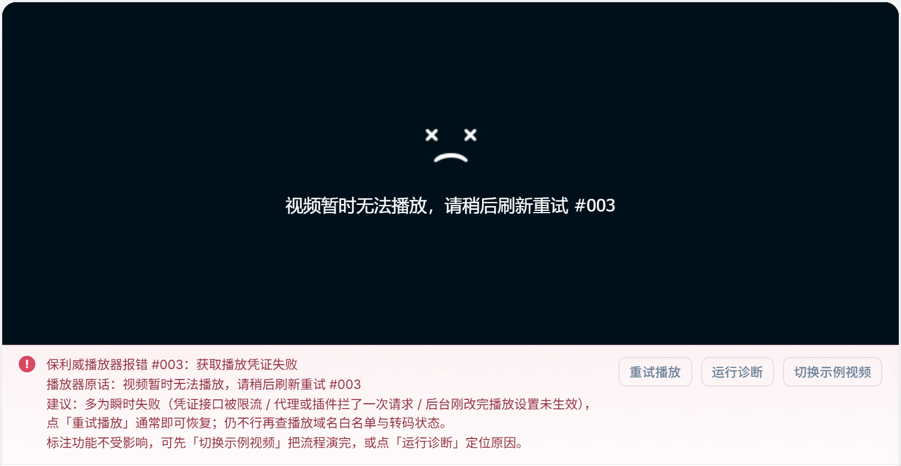 | 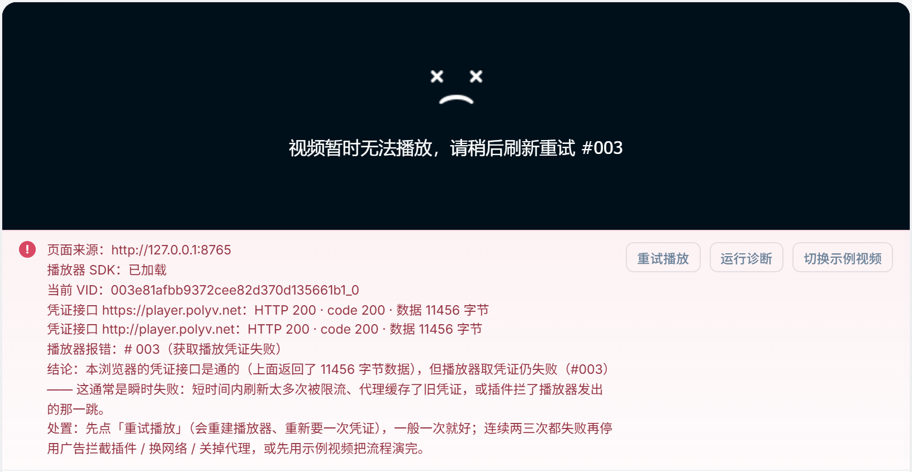 |

---

## 五、保利威 SDK 接入说明

### 5.1 引入

```html
<script src="https://player.polyv.net/resp/vod-player/latest/player.js"></script>
```

### 5.2 创建实例

```js
this.instance = window.polyvPlayer({
  wrap: '#polyvWrap',   // 容器
  width: '100%',
  height: '100%',
  vid: this.opts.vid,   // 点播视频 VID
  autoplay: false,
});
```

### 5.3 监听播放进度（三层保障）

```js
// ① 尝试挂载 SDK 事件（不同版本事件名有差异，逐个 try）
['timeupdate', 'onTimeupdate', 'videoTimeupdate', 'timeUpdate'].forEach(function (name) {
  this.instance.on(name, function () { self._pushTime(self.instance.currentTime); });
});

// ② 绑定容器内原生 <video> 的 timeupdate（最稳定的一层）
video.addEventListener('timeupdate', function () { self._pushTime(video.currentTime); });

// ③ 200ms 轮询兜底，保证 UI 永远跟得上播放器
setInterval(function () { self._pushTime(video.currentTime); }, 200);
```

`_pushTime()` 内部做了去抖动，同一时刻重复回调只渲染一次，避免三路监听导致重复刷新。

### 5.4 定点跳转（seek）

```js
player.seek = function (seconds) {
  if (this.mode === 'polyv' && typeof this.instance.seek === 'function') {
    this.instance.seek(seconds);            // 走 SDK，保证播放器自身状态同步
  } else if (this.videoEl) {
    this.videoEl.currentTime = seconds;     // 演示模式降级
  }
};
```

#### 一个必须踩过才知道的坑：封面层会盖住跳转后的画面

**现象**：视频一次都没播放过时，点时间轴跳到 01:41，播放器显示的**仍然是片头封面图**，
但底下的 `<video>` 其实已经停在 01:41 上了——因为截帧拿到的确实是 01:41 的真实画面。

**定位过程**：先怀疑 seek 没生效，于是把「截帧结果」和「播放器实际画面」分别存成图片对照，
两者内容完全不同；再 dump 播放器 DOM，发现 `.pv-cover`（封面层，含大播放按钮）一直是 `display: block`。
分别在无头 Chrome 和有界面 Chrome 里复现，结论一致——不是无头模式的绘制问题。

**修复**（`player-adapter.js` + `style.css`）：

```js
// 跳离起点后给容器加 .is-seeked，回到 0 秒再摘掉
if (target > 0.5) mount.classList.add('is-seeked');
else mount.classList.remove('is-seeked');
```
```css
#polyvWrap.is-seeked .pv-cover { display: none !important; }
```

修完后：暂停态跳转立刻能看到目标画面；播放不受影响；回到 0 秒封面还会自动回来。

### 5.5 为什么有一层「适配层」

`player-adapter.js` 把「保利威播放器」和「原生 video」收敛成同一套接口（`play/pause/seek/getTime/on('time')`）。
好处是：**业务逻辑（打点、时间轴、笔记、AI）完全不依赖播放器实现**，即使现场网络异常、SDK 加载失败，也能自动降级到示例视频继续演示。

### 5.6 多个视频怎么切换（视频库）

保利威点播播放器一次只吃一个 `vid`，页面本身没有「视频列表」这个概念 —— 所以第一版只能通过
`?vid=xxx` 或改 `config.js` 的 `DEFAULT_VID` 换视频，账号里其他视频在页面上看不到。现在补了一个**本地视频库**。

**入口**：顶部 `VID 003e81af…_0` 徽章（右上角也有一个「视频库」按钮）。

**怎么做**

| 步骤 | 说明 |
| --- | --- |
| 1. 复制 VID | 保利威后台 → 点播 → 视频列表 → 复制 VID（一般以 `_0` / `_8` 结尾） |
| 2. 加进库 | 打开视频库 → 底部输入框粘贴，支持**一次粘多行**；每行可以是 `VID`，也可以是 `名称 VID` / `名称,VID` / `名称\|VID` |
| 3. 切换 | 点卡片上的「打开」（或直接点卡片），整页按 `?vid=` 重载，1 秒内换好 |

清单存在 `localStorage` 的 `labmark.library.v1`，刷新、关机都不丢。每张卡会显示
「短 VID · 该视频的笔记数 · 最后更新时间」，正在看的那条置顶并标「正在观看」。

**数据不会串**：`store.js` 的存储键本来就是 `labmark.v1:<vid>`，切换视频后笔记 / 区间 / 字幕 / 报告
各自独立。从视频库移除一个视频只删清单条目，**标注数据仍在本机**，重新添加同一个 VID 就能找回。

**内置两条**（写在 `config.js` 的 `videoLibrary`，不可删除）：

- `化学滴定 · 实验演示` —— 默认视频；
- `保利威官方示例视频` —— 保底：自己视频在转码 / 被播放限制时，切到它能继续演示。

另外「演示视频 · 40 秒示意」是清单末尾的特殊条目（无需 VID，走原生 video），
原来的「示例视频 / 保利威播放器」二元切换按钮就收在这里，不再单独占一个顶部按钮。

> **为什么不能自动列出账号下的全部视频**
>
> 保利威 VOD 的视频列表接口要用 `secretkey` 参与签名（`sign = md5(secretkey + ...)`）。纯前端意味着
> secretkey 必须写进 JS，任何打开页面的人都能看到；而且该接口也不允许浏览器跨域直连。
> 本项目硬约束是「纯前端、无后端、无数据库」，所以做不了自动拉取 —— 改为手工登记，一次粘贴多行把成本降到最低。
> 若将来加一个极小的服务端中转（几十行），就能改成真·列表，前端这部分 UI 不用动。

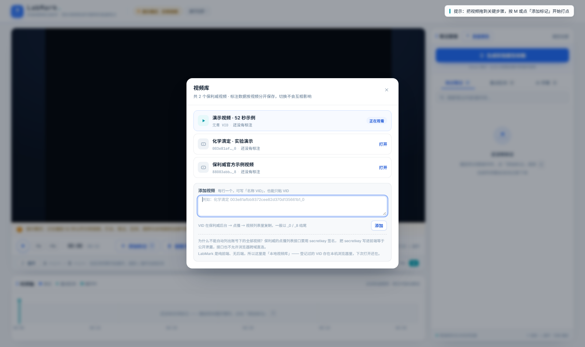

**代码位置**：`assets/js/library.js`（清单读写与校验，约 240 行）+ `app.js` 里的 `renderLibrary / openLibrary / switchVideo / addLibraryFromInput`；
样式在 `style.css` 的「视频库」段。

---

## 六、AI 双模式

### 6.1 模式 A：单帧识别 → 打点笔记（`mode = frame_note`）

点「AI 识帧」或按 `A`：

1. 先在**点击瞬间落点**（时间戳立即固定，不会因为 AI 思考几秒而漂移）；
2. 截取当前画面（含跨域兜底，见下）；
3. 调用模型，按固定格式返回两行，写入该标记的笔记。

输出格式（严格两行，超长自动截断）：

```text
【操作描述】一句话说明当前操作，≤25 字
【易错提醒】提炼1个典型易错点，≤30 字
```

画面看不清时固定输出：

```text
【操作描述】画面识别失败
【易错提醒】无法识别当前实验操作，请手动记录
```

补充能力：点 `AI 识帧 ⋁ → 上传截图识别`，可直接用本地截图走同一套流程。

**稳定性处理**（都是实测踩出来的）：

* **落点与识别解耦**：时间戳在点击瞬间就固定下来，AI 想几秒都不会让标记漂移；
* **失败自动重试一次**：截帧偶发超时、接口偶发抖动都实测出现过，重试一次基本都能救回来；
  但 401 / 403 / 未配置 这类配置错误不重试（重试也没用）；
* **并发保护**：识别进行中再点一次会提示「上一帧还在识别中」，避免连点产生重复打点和重复计费；
* **加载自愈**：如果识别还没返回就刷新 / 关了页面，那条笔记会永久停在「AI 识别中…」，
  现在打开页面会自动把它还原成可手写的空骨架。

**跨域取帧的坑**：保利威视频在 CDN 上（`Access-Control-Allow-Origin: *`），但 SDK 创建的 `<video>` 默认不带 `crossOrigin`，直接 `canvas.toDataURL()` 会抛 `SecurityError`。
兜底方案：新建一个 `crossOrigin="anonymous"` 的隐藏 `<video>`，加载同一地址并 seek 到同一时刻再取帧。
（实测还踩过一个坑：视频停在 0 秒时 `seeked` 事件不会触发，原实现会死等到超时；现已改为 `loadedmetadata → 设置进度`、`loadeddata / seeked → 取帧` 的双事件驱动。）

### 6.2 模式 B：结构化复盘报告（`mode = gen_report`）

点「复盘报告」，把当前视频的**全部打点 + 区间**交给模型，输出固定 4 个模块（标题一字不改）：

```text
1. 📌 实验时间线：按时序精简梳理全部操作步骤
2. ⚠️ 高频易错汇总：合并提取所有标记里的风险、错误操作
3. ✅ 实验复盘建议：给出2~3条预习/重做优化建议
4. 📝 小结：一句话概括本次实验核心重点
```

报告支持：复制、下载 `.md`、重新生成；生成结果与该视频的打点一起存进 localStorage，刷新后仍在。打点数量变化后，报告底部会提示「打点已变化，建议重新生成」。

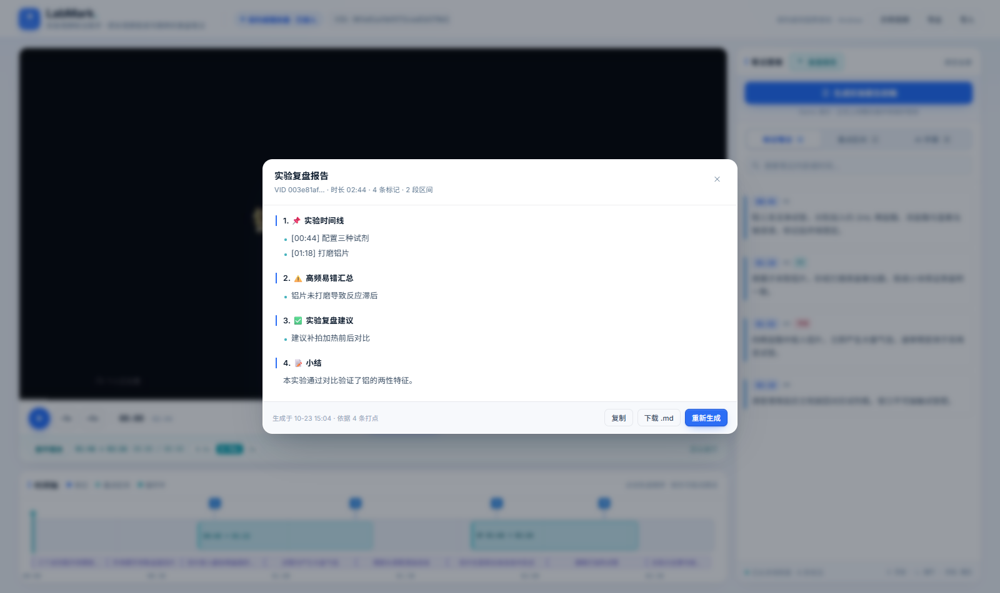

### 6.3 实验报告初稿（6 章，可直接交给老师）

「复盘报告」是给自己看的（时间线 / 易错 / 建议 / 小结），而**实验报告初稿**是给老师看的：
学生只要补上实测数据、计算结果和签名就能交。右侧面板顶部有独立按钮。

业务 prompt 原文照录在 `ai.js` 的 `REPORT_DRAFT_PROMPT` 里，输出结构固定 6 章：

```text
# 实验报告：{根据内容推测的实验名称}
## 一、实验目的      ## 二、实验器材      ## 三、实验步骤
## 四、注意事项与误差分析  ## 五、数据记录  ## 六、思考题与小结
```

打点记录按 `1. [00:12] 笔记内容` 的格式拼进上下文，一次请求拿到整份报告
（实测 4 条打点耗时 **16 秒**、输出 690 字；5 条打点 927 字）。

**几个实现细节：**

| 问题 | 处理 |
| --- | --- |
| 模型不会写 Markdown 表格 / 写了空表 | 自己写了 80 行的极简 Markdown 渲染器，支持 `#` `##` `-` `1.` `>` `---` `**粗体**` `` `code` `` 和表格；表头有、数据行空时自动补一行「（在此填入实测数据）」 |
| 「少于 3 条要加 ⚠️ 提示」模型经常漏 | 代码兜底：`markers.length < 3` 且返回文本里没有「当前标记较少」时，自动补在最前面 |
| 推理模型输出长，容易被 `max_tokens` 截断 | 给到 6000，并且 `finish_reason === 'length'` 时直接报错，不给半截报告 |
| 连点重复生成、重复计费 | `draftBusy` 锁 + 生成期间三个按钮全部 disabled |
| 生成的报告刷新就没了 | 存进 `localStorage` 的 `reportDraft` 字段，下次打开直接显示（打点数变了会提示「建议重新生成」） |

导出四个出口：**一键复制**（复制 Markdown 原文，`clipboard` 不可用时退回 `execCommand`）、
**下载 report.md**（粘进 Word / Typora 都能用），以及 **导出 Word / 导出 PDF**
（连关键帧附录一起打包成 A4 文档，详见 [6.6](#66-导出-word--pdf)）。
左下角「源码 / 排版」可以随时在「渲染后的报告」和「原始 Markdown」之间切换——
演示时给人看排版，交作业时复制源码。

弹层底部有一行小字提醒：**含正文 + 关键帧附录 + 打点清单 · PDF 走浏览器打印**。

| 报告初稿（6 章排版） | 滚动到数据记录表 |
| --- | --- |
| 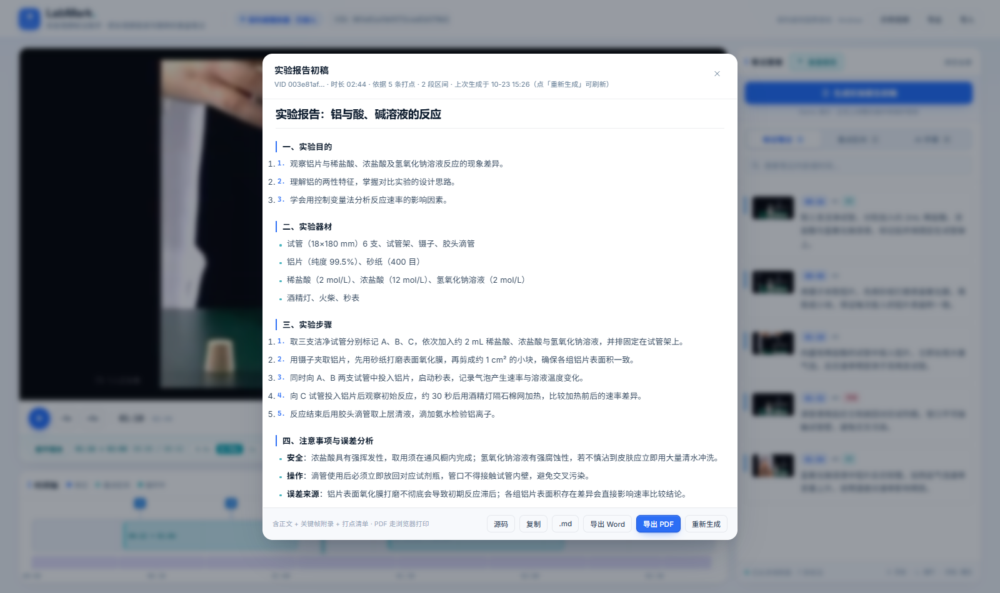 | 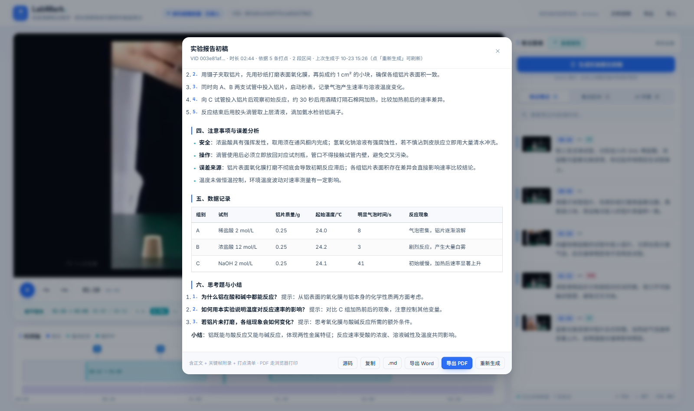 |

### 6.4 语音打点 → 规范笔记

实验室戴着手套、腾不出手打字，是最真实的场景。点「语音打点」（或按 `V`）：

1. `webkitSpeechRecognition`（`lang=zh-CN`, `continuous=true`, `interimResults=true`）开始收音；
2. 边说边在播放器下方显示识别到的原文，页面上能直接看到「它在听」；
3. 一句说完（`isFinal`）→ **立刻按当前播放时间戳落点**，口语原文先存进去；
4. 同时把这句话发给模型，用固定 prompt 洗成 ≤30 字的规范笔记；
5. 回来后就地替换笔记内容，列表、时间轴旗帜、localStorage 同步更新。

实测：口语「哦刚才那个滴管用完之后一定要马上放回原瓶不然会污染试剂」
→ **「滴管使用后应立即放回原瓶，防止试剂污染。」**（20 字，耗时 3.0 秒）。

**保底设计（都很关键）：**

* **先落点再整理**：AI 失败也不丢内容，口语原文就是一条可用笔记，只是不够规范；
* **500ms 级的去重**：`continuous` 模式同一句可能被重复回调，3 秒内同文只记一条；
* **未配置 AI 直接跳过请求**，省一次计费；
* **错误全部翻译成人话**：`not-allowed` → 麦克风权限被拒绝、`no-speech` → 没听到声音（不结束会话）、
  `audio-capture` → 没有麦克风设备、`network` → 识别服务连不上；
* **浏览器不支持**时如实提示（Chrome / Edge，且必须是 localhost 或 https），不做无线麦克风的假象。

#### 识别服务连不上时怎么办（这是最常见的现场问题）

`webkitSpeechRecognition` **不是本地能力**：Chrome 会把音频送到 Google 的识别服务，Edge 送到微软的。
国内网络下 Chrome 基本必然返回 `network` 错误 —— 这不是代码写错了，是服务到不了。

所以这一版把「失败」当成一条正常路径来设计：

| 情况 | 现在的行为 |
| --- | --- |
| `network` 第一次失败 | **自动重试一次**（提示条显示「识别服务没连上，正在重试一次…」），避开瞬时抖动 |
| 重试仍失败 | 提示条变成橙色常驻，文案直接说明原因，并**同时摆出「手动输入」按钮** |
| `not-allowed` | 给出「点地址栏的锁 → 允许麦克风 → 点重试」的具体路径 |
| `audio-capture` | 提示没有麦克风设备，同样可以直接手动输入 |
| 浏览器根本没有这个 API | 提示换 Chrome / Edge，直接走手动输入 |

**「手动输入」不是一个降级提示，而是一条完整通路**：点一下，语音条原地变成输入框，
敲一句话回车 → 走**和语音完全一样**的落点 + AI 整理链路（`source` 仍然记为 `voice`），
所以现场哪怕麦克风坏了、网断了，这条功能线也演得下去。

> 实测：headless Chrome 下点「语音打点」→ 命中 `not-allowed` → 提示条转橙、`结束录音` 收起、
> `手动输入` 与 `重试` 出现；展开输入框（自动聚焦）→ 输入 20 字口述 → 回车 →
> 打点落在当前时间、`source=voice`、列表与 localStorage 同步，耗时 0.9 秒。

### 6.5 关键帧缩略图

每次打点都会顺手截下这一秒的画面，存成 320px 宽的 JPEG 塞进 `marker.thumb`。右侧笔记列表于是从「文字列表」变成「缩略图 + 文字」的卡片，点击可看大图。

**这一版重做了取帧的失败路径** —— 之前「打完点看不到图」有两个真实原因，都在这版修掉了：

| 症状 | 原因 | 现在怎么做 |
| --- | --- | --- |
| 打完点**完全没有图，也不报错** | 取帧要 seek，通常 200ms~2.6s 才出图；这段时间列表里什么都没有，看起来就像「没这个功能」 | 打点瞬间**先摆一块「截取中」骨架**（`.note-thumb.is-pending`），图到了原地替换 |
| 视频还没解码出画面就打点 | 旧代码 `if (!v.videoWidth) return;` —— **直接放弃，永不重试** | **进队列**（`thumbQueue`），等播放器真的出画面再统一补拍，最多等 16 秒 |
| 视频源不给 CORS 头 | `drawImage` 后 canvas 被判定跨域污染，`toDataURL` 抛 `SecurityError`，整条永久失败 | 失败就记进 `thumbFailed`，卡片上出现**虚线相机占位**，点一下重新截；演示源改为**同源本地片段**，从根上避开污染 |

```js
// app.js —— 三种状态：ok / pending / missing
var thumbQueue = [];     // 等画面就绪后补拍
var thumbFailed = {};    // 彻底失败的，给一个可点的占位

function grabThumb(id, force) {
  var m = findMarker(id);
  if (!m || (m.thumb && !force)) return;

  if (!videoPaintable()) {                 // readyState < 2 或 videoWidth = 0
    if (thumbQueue.indexOf(id) < 0) thumbQueue.push(id);
    paintThumb(id);                        // 渲染骨架
    scheduleThumbFlush();                  // 轮询等画面，最多 16 秒
    return;
  }
  getGrabber().grab(m.time, 320, 0.72)
    .then(function (url) { m.thumb = url; delete thumbFailed[id]; persist(); paintThumb(id); })
    .catch(function () { thumbFailed[id] = true; paintThumb(id); });   // 变虚线占位
}
```

四个实现细节值得说：

1. **为什么会 taint，以及两条取帧路径**。保利威的 `<video>` 跨域且没带 `crossOrigin`，直接 `drawImage` 会让 canvas 污染，`toDataURL` 抛 `SecurityError`。所以 `makeGrabber()` 内部有两条路：**主画面就在当前时间点、且没污染 → 直接取**（零延迟）；否则**复用一个带 `crossOrigin='anonymous'` 的副本 video，串行 seek → 截帧**。实测真实实验视频（`dpv.videocc.net`，带 CORS）第一次 2.6 秒、之后每张 **420ms**。

2. **为什么演示源最后换成了本地文件**。这一条踩了三层坑，值得完整记下来：

   | 换过的源 | 结果 |
   | --- | --- |
   | `media.w3.org/.../sintel/trailer.mp4` | **不带 `Access-Control-Allow-Origin`**，副本 video 加载直接 `Format error`，缩略图一张都没有 |
   | `cdn.jsdelivr.net/.../big_buck_bunny.mp4` | 带 `ACAO: *`，能取帧了；**但首次要 10.3 秒才出画面**。演示现场往往就是弱网，这 10 秒里打点全部落到「画面未就绪」队列，等满 16 秒后统一标记失败 —— 看起来仍然是「没有缩略图」 |
   | `vjs.zencdn.net/v/oceans.mp4` | 国内能连，但 **46MB**，更慢 |

   于是改成**随仓库分发的本地片段** `assets/media/demo-lab.webm`（40 秒 / 960×540 / 4MB）：
   **同源**（canvas 永不污染）、**51ms 就绪**（不再有「等画面」的窗口）、**随机 seek 正常**（时间戳跳转和取帧都靠它）。
   实测打点→出图 **约 300ms**，3/3 全部成功。

   这个片段是用 canvas 逐帧画出来、再用 `MediaRecorder` 录制的操作示意动画（滴定装置、加液、指示剂变色四步），
   画面左上角明确标注「示意动画，非真实实验录像」—— 演示归演示，不假装是真实素材。

   > 顺带记一个坑：`MediaRecorder` 产出的 webm 没有 cues 索引，一般播放器无法 seek。
   > Chrome 能读到时长的前提是它自己扫了簇；为确认这一点，专门按时间点取样比对了画面哈希
   > （0 / 6 / 14 / 22 / 30 / 36 秒六个值全不相同），确认 seek 真的生效才敢用。

3. **为什么只替换单条 DOM**。`paintThumb(id)` 只改那一条 `<li>` 里的缩略图，不走 `renderNotes()` 全量重绘 —— 否则用户正在输入笔记时会被打断焦点。

4. **localStorage 只有 5MB**。一张约 18KB，所以设了两道闸：**最多 50 张 + 总字节不超过 1.6MB**，超了从 `createdAt` 最旧的开始丢图（**只丢图，笔记文字一律保留**）。逻辑在 `store.js` 的 `pruneThumbs()`，每次 `save()` 前跑一遍。

> 实测：真实实验视频（保利威 VID，164 秒，`dpv.videocc.net` 跨域 mp4）3 条打点
> （00:12 / 00:35 / 02:20）→ 3 张缩略图 **563~1194ms 全部到位**，三张内容明显不同
> （试剂瓶特写 / 滴定操作 / 终点读数），打开大图正常，没有一次落到虚线占位；
> 演示模式 3 条打点 **约 300ms/张**；第 51 条开始最旧的那张自动消失，文字还在。

---

### 6.6 导出 Word / PDF / Markdown

**为什么加这个**：AI 生成的是 Markdown，学生拿着一个 `.md` 文件是交不了作业的 —— 手机打不开、Word 不认、老师也未必知道 md 是什么。这一层把「报告正文 + 实验元信息 + 关键帧截图 + 打点清单」拼成一份 A4 文档。

**入口在顶部「导出 ⌄」**（这一版从二级弹层提上来）：

| 菜单项 | 产出 | 说明 |
| --- | --- | --- |
| **Word 文档** | `.doc` | HTML + `Blob(application/msword)`，带 Office 命名空间 + `WordSection1` 分页容器，Word / WPS 都能打开继续编辑 |
| **PDF 文档** | 浏览器打印 | 隐藏 iframe + `window.print()`，用户在打印面板里选「另存为 PDF」 |
| **Markdown** | `.md` | 有 AI 报告导报告，没有就用打点记录拼一份 |
| **JSON 备份** | `.json` | 原「导出」，可跨设备恢复（按 id 去重合并） |
| **导入 JSON** | — | 从备份恢复 |

**关键改动：不再必须先有 AI 报告。** 之前 Word 按钮只藏在「实验报告初稿」弹层底部，必须先成功生成一次报告才看得到 —— 没网、没配 key、或者模型抽风时，整条导出线就是死的。现在 `exportPayload()` 在正文为空时调用 `fallbackBodyHTML()`，自动把打点 + 区间拼成「实验过程记录」，标题也如实写「实验过程记录」而不是假装是完整报告。导出前还会先给缺图的打点**补拍一次关键帧**（最多等 1.5 秒），保证 Word 里的图是齐的。

两个坑踩过才知道：

1. **Word 不认 flex / grid**。所以关键帧附录用的是 `<table>`（两列一行），图片靠 `width="300"` 属性定宽，不靠 CSS。用 flex 的话在 Word 里会全部塌成一行。

2. **PDF 必须等图片解码完再 print**。base64 图片在 `print()` 那一刻还没 decode 完，打出来就是一堆空白框。所以先 `doc.images` 逐个等 `load`/`error`，全部 settle 后再调 `print()`，另加 5 秒兜底。
   还有一个隐蔽点：iframe 宽度不能设成 1px —— 部分浏览器会按 1px 视口先排版一次，打印出来的版式是错的。改成给一个接近 A4 的 820×1160 再挪到屏幕外。

导出的文档结构：

```text
实验过程记录（有 AI 报告时是「实验报告：{正文一级标题}」）
├── 元信息表（实验视频 / 打点数量 / 重点区间 / AI 字幕 / 导出时间）
├── 正文
│   ├── 有 AI 报告：一、实验目的 … 六、思考题与小结（6 章）
│   └── 没有报告：一、实验过程记录（打点清单）/ 二、重点操作区间
├── 附录 · 实验过程关键帧（两列，每张图带时间戳 + 笔记）
└── 附录 · 重点区间（时间段 / 时长 / 备注）
```

> 实测（真实实验视频，未生成 AI 报告）：3 条打点 → `.doc` **23.8KB、3 张内嵌关键帧、2 个表格**，
> 标题自动取「实验过程记录」，笔记原文完整保留；
> 有报告的场景此前实测为 `.doc` 33KB、4 张关键帧，`Page.printToPDF` 生成 **3 页 A4、191KB**。

| 导出文档 · 正文 | 导出文档 · 关键帧附录 |
| --- | --- |
| 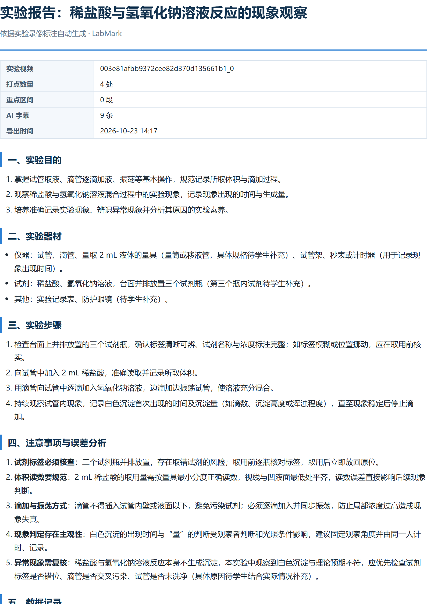 | 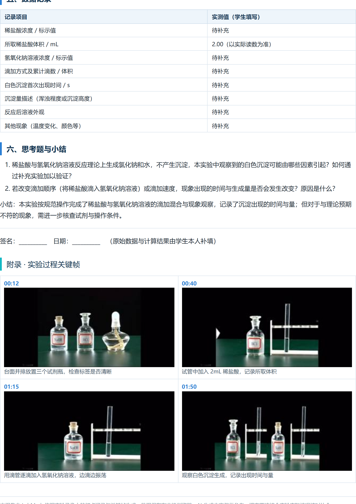 |

---

### 6.7 AI 字幕

**先说清楚它是怎么来的，因为这里有个技术取舍。**

原始想法是「把视频里的声音转写成字幕」。我实测了三步：

1. `getVideoEl().captureStream()` → **直接抛 `SecurityError`**（跨域且没带 `crossOrigin`）；
2. 换成带 `crossOrigin='anonymous'` 的副本 video → **能拿到 `audio/live` 轨道，AnalyserNode 采样峰值 0.13，是真声音**（48kHz）；
3. 把这段音频送给模型 → **`input_audio` 返回 400（模型不支持音频输入），专用 ASR 模型 `qwen3-asr-flash` 返回 403（当前 key 只授权了 `deepseek-v4.1-flash-1017` 一个模型）**。

所以在这套 key 权限下，**音频转写这条路走不通**。于是换成同样能达成目的的方案：**按时间段抽帧 + 多模态理解画面**，生成分段字幕。

这个取舍对实验视频其实更贴场景 —— 实验录像的关键信息在画面上（在做什么操作、用了什么仪器、出现了什么现象），而不是旁白；很多实验视频甚至根本没有人声。

流程：

```text
按 20 秒切段 → 每段取中点抽一帧（448px）
  → 每 6 帧打包成一次请求，让模型按 "序号|说明" 格式输出
  → 多批并发（实测把 9 段从 57 秒压到 19 秒）
  → 解析成字幕数组，铺到时间轴下方 + 面板第三个标签页
```

几个实现要点：

- **取帧走独立副本 video，不碰主播放器** —— 生成期间用户可以继续正常观看，不会被 seek 打断（这点和「AI 识帧」不同）。
- **单批失败不拖垮整体**：`Promise.all` 里每个 batch 各自 catch，最后只要有任意条目就算成功。
- **宽度用 `calc(W% - 2px)`**，相邻字幕块之间留 2px 缝隙，否则会糊成一条看不出分段。
- 长视频有保护：段数超过 40 会自动加大分段长度，避免一次点出几十个请求。

> 实测：《铝与酸、碱溶液的反应》02:44 → 切 9 段 → **19 秒生成 9 条字幕**。内容摘录：
> `0s 三个试剂瓶并排放置在绿色桌面上` / `20s 手打开盐酸试剂瓶瓶塞` / `40s 盐酸试剂瓶与试管架并置` /
> `1:00 手执滴管向试管中滴加液体` / `1:20 氢氧化钠瓶旁试管壁无色液体`。
> 点第 3 条字幕 → 播放器跳到 40s（目标 40s，实测 40s）。


---

### 6.8 AI 配置（不改代码也能换）

当前接的是**阿里云百炼（DashScope）**上的 **DeepSeek v4.1 Flash**，走 OpenAI 兼容模式：

```js
// assets/js/config.js
ai: {
  baseUrl: 'https://dashscope.aliyuncs.com/compatible-mode/v1',
  apiKey: 'sk-ws-...',
  model: 'deepseek-v4.1-flash-1017',        // 生成报告
  visionModel: 'deepseek-v4.1-flash-1017',  // 识帧（该模型本身支持图片）
  supportsVision: true,
  timeout: 90000,                           // 推理模型首字慢，给足
}
```

> **这串 key 属于百炼，不是 DeepSeek 官方。** 两者域名、模型名都不一样：
> `api.deepseek.com` 用的模型名是 `deepseek-chat`，百炼用的是 `dashscope.aliyuncs.com` + `deepseek-v4.1-flash-1017`。
> 拿到百炼的 key 去打 DeepSeek 官方域名，一定是 `401 Authentication Fails`——这是最容易踩的坑。

#### 推理模型的三个特殊处理

`deepseek-v4.1-flash` 是**推理模型**，返回体里除了 `content`（正文）还有 `reasoning_content`（思考过程），由此带来三个必须处理的点：

1. **`max_tokens` 要把思考算进去。** 实测 `max_tokens: 20` 时，20 个 token 全被思考吃掉，`content` 返回空字符串。
   现在识帧给 1500、报告给 4000，「测试连接」给 512。
2. **判断成败不能只看 `content` 是否为空。** 空的时候要看 `finish_reason`：
   `length` → 是被截断（会把 `max_tokens` 用尽），`stop` + 空正文 + 有 reasoning → 是只想了没答。两种都给出了不同的中文提示。
3. **`chat()` 返回的是对象而不是字符串**：`{ text, finish, reasoning, usage }`，
   这样上层才能区分「截断」和「空回复」，报告被截断时直接报错而不是给半截内容。

#### 服务商预设

页面里点 `AI 识帧 ⋁ → AI 设置…`，第一栏就是**服务商预设**，选中后 baseUrl / 模型 / 识帧模型自动填好：

| 预设 | baseUrl | 文本模型 | 识帧模型 |
| --- | --- | --- | --- |
| **阿里云百炼（默认）** | `https://dashscope.aliyuncs.com/compatible-mode/v1` | `deepseek-v4.1-flash-1017` | `deepseek-v4.1-flash-1017` |
| DeepSeek 官方 | `https://api.deepseek.com/v1` | `deepseek-chat` | 需另配多模态 |
| 硅基流动 SiliconFlow | `https://api.siliconflow.cn/v1` | `Qwen/Qwen2.5-7B-Instruct` | `Qwen/Qwen2-VL-72B-Instruct` |
| 智谱 GLM | `https://open.bigmodel.cn/api/paas/v4` | `glm-4-flash` | `glm-4v-flash` |
| Moonshot Kimi | `https://api.moonshot.cn/v1` | `moonshot-v1-8k` | `moonshot-v1-8k-vision-preview` |
| 本地 Ollama | `http://localhost:11434/v1` | `qwen2.5:7b` | `llava` |
| 自定义 / 自建网关 | — | — | — |

模型名只是能跑通的示例，可随手改。弹层里有三个按钮：

* **测试连接**：用表单里当前的值打一发最小请求，**不落盘**，结果直接显示在弹层里；
* **可用模型**：拉取当前网关的完整模型列表（实测百炼这个 key 有 **178 个**模型），
  全部塞进模型输入框的 datalist 供下拉选择，并顺带列出可识帧的多模态模型——
  现场换 key 时不用再猜模型名到底叫什么；
* **保存并测试**：先存进 localStorage，再验证一次；成功自动关闭弹层，失败保持打开并标红。

失败时弹层里展示的是**服务端原话**，例如：

```text
❌ AI 接口 401：key 无效，或与当前 baseUrl 不匹配
（服务端返回：Authentication Fails, Your api key: ****GsvE is invalid）
```

看到 `is invalid` 就是 key 本身不能用；看到 `404 / model not found` 才是模型名或 baseUrl 不对——
这两种情况的处理方式完全不同，所以必须把原话透出来，不能只给一句「请求失败」。

另外，AI 调用时遇到 401 / 403，会自动把设置弹层打开并标红，省得用户只看到一个 toast 不知道下一步做什么。

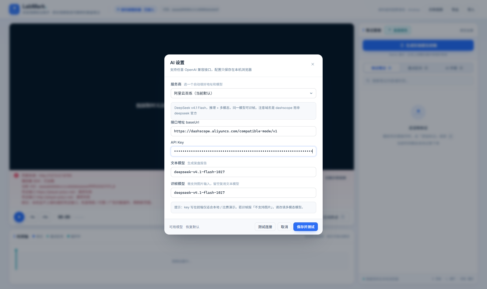

> ⚠️ **两个必须知道的限制**
> 1. **key 写在前端等于公开**：任何打开页面的人都能在源码里看到。比赛本地演示可接受，一旦部署公网，必须改为服务端中转（key 挪到后端，前端只调自己的接口）。
> 2. **识帧需要多模态模型**：不是所有模型都吃图片。`deepseek-v4.1-flash` 本身支持图片输入，所以识帧能复用同一个模型；换成纯文本模型（如 `deepseek-chat`）就必须另填 `visionModel`，否则报 400。

---

## 七、A-B 循环播放

实验操作往往只有两三秒（点火、滴定终点、读数），正常速度根本看不清。循环播放把「重点区间」变成观察台：

1. 用 `I` / `O` 圈出一段区间（原有功能，没有改）；
2. 区间条目右侧点 **⟳ 循环**，播放器跳到 A 点并开始播；
3. 播放到 B 点自动 seek 回 A 点，反复循环；
4. 播放器下方出现循环控制条：`循环播放 | 00:44 → 01:02 | 00:05 / 00:18 | 0.5x 0.75x 1x | 退出循环`；
5. 再点一次「⟳」或「退出循环」即结束，倍速自动回到 1x。

**实现的三个关键点：**

```js
// 1) 只在「正在播放」时跳，用户手动暂停不该被拽走
// 2) loopSeeking 挡住 seek 触发的 time 回灌，避免同一帧内反复跳
function checkLoop(t) {
  var r = currentLoopRange();
  if (!r) return;
  updateLoopProgress(t, r);
  if (loopSeeking || !player.isPlaying()) return;
  if (t < r.end - 0.04) return;
  loopSeeking = true;
  player.seek(r.start);
  if (!player.isPlaying()) player.play();   // 部分皮肤 seek 后会短暂 pause
  setTimeout(function () { loopSeeking = false; }, 240);
}
```

* **精度**：`timeupdate` + 200ms 轮询双路推送，实测 2 秒区间连播 6 秒跳回 3 次，
  采样最大值为 `6.98`（终点 7.0），误差 < 0.1 秒；
* **倍速**：`player.setRate()` 同时写原生 `video.playbackRate` 与 SDK 的 `setSpeed`，
  保证播放器自己的速度标签和实际速度一致；
* **视觉**：时间轴上该区间改成**斜纹高亮 + 实心描边 + `⟳` 前缀**，区间条目左边框加粗，
  图例新增「循环中」，一眼能看出哪一段在循环。

循环状态（区间 id + 倍速）也存进 localStorage，刷新后自动恢复，但**不会自动播放**——
避免一打开页面视频就自己动起来。


---

## 八、目录结构

```text
labmark/
├── index.html                  页面结构（三栏 + 报告 / 报告初稿 / 视频库 / AI 设置 / 关键帧预览 五个弹层）
├── assets/
│   ├── css/style.css           设计令牌 + 全部样式（无第三方 UI 框架）
│   ├── media/
│   │   └── demo-lab.webm       演示片段 40 秒 / 960×540 / 4MB（canvas 绘制 + MediaRecorder 录制，同源）
│   └── js/
│       ├── config.js           全局配置（VID、演示源、视频库内置条目、配色、AI 接口、URL 参数）
│       ├── library.js          视频库（多 VID 清单：添加 / 移除 / 概览统计，存 localStorage）
│       ├── store.js            localStorage 持久化（校验 / 合并 / 报告缓存 / 循环状态 / 缩略图容量裁剪）
│       ├── player-adapter.js   播放器适配层（保利威 SDK ↔ 原生 video，含倍速）
│       ├── ai.js               AI 能力层（取帧器 / 识帧 / 复盘报告 / 报告初稿 / 语音整理 / 分段字幕）
│       ├── export.js           导出层（拼 A4 文档 → Word .doc / 浏览器打印 PDF）
│       └── app.js              应用主逻辑（打点 / 笔记 / 缩略图 / 区间 / 循环 / 语音 / 字幕 / AI 交互）
├── docs/                       界面截图与导出效果
└── README.md
```

> 为什么把演示片段放进仓库：演示模式的存在意义是「现场出问题时还能演」，
> 如果它自己依赖外网 CDN，就等于把兜底押在了最不稳定的那一环上。4MB 的体积换一个
> 断网可用的演示闭环，值。

---

## 九、数据存储

- 存储位置：`localStorage`，键名 `labmark.v1:<vid>`（演示模式为 `labmark.v1:demo`），**换视频不串数据**。
- 视频库清单单独存 `labmark.library.v1`（不随视频切换而变），详见 5.6。
- AI 配置单独存：`labmark.ai`（只在本机生效，不随代码走）。

```json
{
  "version": 1,
  "vid": "003e81afbb9372cee82d370d135661b1_0",
  "markers": [
    { "id": "m_xxx", "time": 58.4, "note": "【操作描述】…\n【易错提醒】…", "color": "#e8a33c", "source": "ai", "thumb": "data:image/jpeg;base64,…", "createdAt": 1792722929000 },
    { "id": "m_yyy", "time": 88.6, "note": "滴管使用后应立即放回原瓶，防止试剂污染。", "color": "#e2667d", "source": "voice", "thumb": "data:image/jpeg;base64,…", "createdAt": 1792722929000 }
  ],
  "ranges": [
    { "id": "r_xxx", "start": 18, "end": 46, "note": "铝与稀盐酸反应", "color": "#14b8c4", "createdAt": 1792722929000 }
  ],
  "subtitles": [
    { "id": "s_xxx", "start": 0, "end": 20, "text": "三个试剂瓶并排放置在绿色桌面上", "createdAt": 1792722929000 },
    { "id": "s_yyy", "start": 20, "end": 40, "text": "手打开盐酸试剂瓶瓶塞", "createdAt": 1792722929000 }
  ],
  "report": { "text": "📌 实验时间线…", "at": 1792722930000, "count": 4 },
  "reportDraft": { "text": "# 实验报告：…", "at": 1792722930000, "count": 4 },
  "loop": { "id": "r_xxx", "rate": 0.5 },
  "updatedAt": 1792722930000
}
```

`source` 有三种：`manual`（手打）、`ai`（识帧生成）、`voice`（语音打点），
对应列表里三种不同的来源徽标。

- 输入笔记时 250ms 防抖落盘，页面底部实时提示「已保存到本机 · 时间」。
- 读取时对所有字段做类型校验与截断，脏数据不会破坏渲染；
  `loop.id` 指向的区间若已被删除，下次打开会自动清空循环状态。
- `thumb` 只接受 `data:image/(jpeg|png|webp);base64,` 开头的字符串，且单张上限 400KB ——
  防止导入的脏 JSON 把整个列表撑爆。写入前还会跑一次 `pruneThumbs()`：
  **最多 50 张、总字节 ≤1.6MB**，超了按 `createdAt` 从最旧的开始清空 `thumb`（笔记文字不动）。

---

## 十、快捷键

| 按键 | 作用 |
| --- | --- |
| `空格` | 播放 / 暂停 |
| `M` | 在当前时刻添加标记 |
| `V` | 开启 / 关闭语音打点 |
| `A` | AI 识帧，生成打点笔记 |
| `I` | 设置重点区间起点 |
| `O` | 设置重点区间终点 |
| `L` | 当前高亮区间（或第一个区间）开启 / 关闭循环 |
| `←` / `→` | 后退 / 前进 5 秒 |
| `Esc` | 关闭弹层 / 从输入框失焦 |

在输入框内输入时快捷键自动失效，不会误触。

---

## 十一、已验证事项（真实运行记录）

用无头 Chrome + CDP 驱动真实页面实测，控制台无报错：

**播放器 / 标注**

- ✅ 保利威播放器实例创建成功，`currentSrc` 来自 `dpv.videocc.net`，时长 02:44
- ✅ 播放 1.6 秒后时间从 5.46s 前进到 7.07s；暂停即停
- ✅ 点击时间轴 70% → seek 到 01:55 并正确渲染
- ✅ 打点 → 写笔记 → 点旗帜跳回，闭环成立
- ✅ 刷新后标记 4 条、区间 2 条、笔记文字全部恢复
- ✅ `file://` 直接双击打开同样可播放、可标注（无需服务器）

**播放异常兜底（`#003` 排障链路）**

- ✅ 注入 `Error code: #003` 面板 → 400ms 内识别，提示条显示「保利威播放器报错 #003：获取播放凭证失败」+ 建议
- ✅ 把 `videojson` 请求 abort 掉（模拟插件拦截）→ 930ms 自动重试提示 → 2.1s 重建播放器 → 仍失败才亮按钮，全程无「静默黑屏」
- ✅ 恢复网络后点「重试播放」→ 约 1s 拿回 164.4s 时长、提示条自动收起、错误状态清零（`_lastError = null`）、打点与缩略图正常
- ✅ 点「运行诊断」→ 打出来源 / SDK / VID / https 与 http 两个凭证接口的状态与数据大小，并给出结论
- ✅ 接口通、数据正常但仍报 `#003` → 结论准确落在「先重试，别去改后台设置」
- ✅ 无效 VID（凭证接口只返回 160 字节）→ 诊断结论准确指出「视频侧不可播」
- ✅ 点「切换示例视频」→ 立刻降级到演示模式，提示条收起，标注功能不受影响
- ✅ 正常视频（02:44）下不误报：提示条始终隐藏；1280 / 1366 / 1440 / 1920 四档宽度下三按钮不换行、无溢出

**AI（已接真实接口：阿里云百炼 DeepSeek v4.1 Flash）**

- ✅ 模式 A：01:38（试剂瓶与试管架）、00:57（火柴靠近试管口）两个时刻均正确取帧 → 两行笔记写入 → 时间轴自动出旗帜 → 笔记带 AI 标记
- ✅ 模式 B：4 条打点 + 1 段区间 → 输出 4 个模块，标题严格为 📌/⚠️/✅/📝，能指出「点燃前未验纯」「残留盐酸未润洗」这类真实风险
- ✅ 报告与打点一起持久化，刷新后重新打开弹层仍是上次结果
- ✅ 「可用模型」拉到 **178 个模型**并填进 datalist，同时列出可识帧的多模态模型
- ✅ 服务商预设 7 项（含百炼），切换即自动填 baseUrl / 模型 / 识帧模型
- ✅ 「测试连接」用表单值试打一发、不落盘：坏 key 标红并显示服务端原话，好 key 显示「连接正常，模型返回：正常」
- ✅ 「保存并测试」：成功后自动关弹层，失败保持打开并标红
- ✅ AI 调用遇 401 时自动打开设置弹层并标红，不用用户自己找入口
- ✅ 并发保护：识别中再次点击只提示，不会产生重复标记
- ✅ 加载自愈：「AI 识别中…」的残留标记会还原成空骨架
- ✅ 封面层修复：暂停态 seek 后立刻看到目标画面（修复前会一直显示片头，实测有界面 / 无头 Chrome 均复现）
- ✅ 报告排版：`📝 小结：xxx` 这种「标题和正文同一行」的输出能正确拆成第 4 个模块

> 早期这串 `sk-ws-` key 曾在 `api.deepseek.com` 上反复 401，是因为它属于**阿里云百炼**而非 DeepSeek 官方。
> 换成 `https://dashscope.aliyuncs.com/compatible-mode/v1` + `deepseek-v4.1-flash-1017` 后一次性跑通，代码一行没改。

**新增能力（三个功能都跑过真实页面）**

- ✅ 实验报告初稿：4 条打点 → **16.0 秒**返回，`<h1>` + 6 个 `<h2>` 章节齐全，`五、数据记录` 输出为真实 Markdown 表格（项目 / A 管 / B 管 / 待填），列表 4 条有序步骤
- ✅ 报告初稿持久化：写进 `reportDraft`，重新打开弹层直接显示，不再重复请求
- ✅ 少于 3 条打点：2 条 → 报告开头自动带「⚠️ 当前标记较少，报告内容仅供参考，请补充完整后再生成」
- ✅ 生成中状态：弹层显示「正在把 N 条打点整理成实验报告初稿…」，三个按钮全部 disabled，连点不会重复请求
- ✅ 下载：点「下载 report.md」成功触发下载并提示；复制：`clipboard` 与 `execCommand` 两条路都通
- ✅ 零打点时点按钮：提示「先打几个点，AI 才有素材」，不弹空弹窗
- ✅ 语音打点：注入可编程的 `SpeechRecognition` 后，口语长句 → 落点（时间戳 00:21，与当前播放位置一致）→ AI 整理 **3.0 秒** → 「滴管使用后应立即放回原瓶，防止试剂污染。」（20 字 ≤ 30 字）→ 列表 / 时间轴 / localStorage 三处同步
- ✅ 语音错误兜底：`not-allowed` → 「麦克风权限被拒绝，请允许麦克风后重试」，按钮自动复位；浏览器不支持时给出换 Chrome 的提示
- ✅ A-B 循环：区间 5→7 秒，采样 6 秒内**跳回 3 次**，采样最大值 `6.98`（不越过 7.0）
- ✅ 循环倍速：切 0.5x / 0.75x → `video.playbackRate` 同步为 0.5 / 0.75，按钮高亮与区间标签同步显示 `⟳0.5x`
- ✅ 退出循环：倍速恢复 1x、时间轴高亮移除、状态条收起
- ✅ 刷新恢复：循环区间与倍速存进 localStorage，刷新后状态条与高亮自动回来（不自动播放）
- ✅ 布局：语音条 + 循环条同时显示时，播放器仍有 437px、时间轴完整在视口内、页面无纵向溢出
- ✅ 回归：打点 / 笔记 / 时间轴跳转 / 区间 / 刷新恢复 / 旧复盘报告 4 模块 / 复制 / 演示模式，19 项全通过，控制台零报错

**第二批新增（缩略图 / 导出 / 字幕，全部真机跑过）**

- ✅ 关键帧缩略图：4 条打点 → 4 张自动生成，总计 9KB；刷新后全部恢复；点击打开大图且时间戳正确
- ✅ **缩略图根因修复（本轮）**：演示源从外链改成本地同源片段后，就绪时间 10302ms → **51ms**，
  打点出图 **300ms/张**，3/3 成功、零虚线占位；真实 VID（164 秒跨域 mp4）同样 **563~1194ms/张**
- ✅ **取帧路径实测**：真实 VID 下直接 `drawImage` 抛 `SecurityError`（符合预期），
  副本 video（`crossOrigin='anonymous'`）兜底取帧成功，说明「跨域也能有图」这条路是通的
- ✅ **导出入口外显**：顶部「导出」下拉一屏可见 Word / PDF / Markdown / JSON 四个出口，
  不用再进二级弹窗找；导出的 `.doc` 实测 22.7KB、3 张内嵌关键帧、2 个表格、无「尚未生成报告正文」占位
- ✅ 缩略图容量：`pruneThumbs()` 按「50 张 / 1.6MB」双闸淘汰最旧的图，笔记文字不受影响
- ✅ 缩略图不影响原有交互：`paintThumb()` 只改单条 DOM，输入笔记时不会被全量重绘打断焦点
- ✅ 导出 Word：真实下载到磁盘的 `.doc` 含 Office 命名空间、`WordSection1`、6 个 `<h2>`、3 个 `<table>`、4 张内嵌 JPEG，共 33KB
- ✅ 导出文档渲染：去掉 Word 包装后按 HTML 打开，6 章正文 + 元信息表 + 关键帧附录（两列、带时间戳与笔记）排版全部正常
- ✅ 导出 PDF：用 `Page.printToPDF` 生成的真实 PDF 为 **3 页 A4 / 4 张内嵌 JPEG / 191KB**
- ✅ 报告标题去重：Markdown 开头的 `# 实验报告：xxx` 被剥掉，文档里不会出现两次标题
- ✅ AI 字幕：02:44 视频切 9 段 → **19 秒**生成 9 条字幕，内容与画面一致（试剂瓶摆放 / 打开瓶塞 / 滴加液体 / 沉淀生成）
- ✅ 字幕并发：分批串行 57 秒 → 并发后 19 秒，提速 3 倍
- ✅ 字幕交互：铺到时间轴下方、面板第三标签页同步、点第 3 条跳到 40s（目标 40s，实测 40s）
- ✅ 字幕搜索：搜索框输入关键词可过滤字幕
- ✅ 三标签页互斥：`标记笔记 / 重点区间 / AI 字幕` 切换后列表可见性正确
- ✅ 生成字幕期间主播放器不受影响（取帧走独立副本 video，不 seek 主画面）
- ✅ 布局：字幕轨显示后播放器仍有 449px，页面纵向溢出为 0
- ✅ 回归：17 项全通过（播放器就绪 / 打点 / 笔记落盘 / 时间戳跳转 / 区间 / 循环 / 倍速 / 退出恢复 / 三标签页 / 快捷键 M / 刷新恢复 / 缩略图刷新后仍在 / JSON 备份 / 无溢出 / 零异常）

**第三批修复（语音兜底 / 取帧失败路径 / 导出入口，均为真机复现后修的）**

- ✅ 缩略图根因定位：`media.w3.org` 的演示源**不返回 `Access-Control-Allow-Origin`**，
  副本 video 直接 `MEDIA_ELEMENT_ERROR: Format error` → 这就是「`?demo=1` 下一张缩略图都没有」的原因；
  换源到 `cdn.jsdelivr.net`（5.5MB / 60 秒，`ACAO: *`）后 **3/3 成功**
- ✅ 缩略图时序：真实实验视频打 3 个点 → 首次 **2.6 秒**、后续每张 **420ms**；
  打点瞬间先渲染「截取中」骨架，实测 `pendingSeen = true`，不再是「一片空白」
- ✅ 缩略图兜底：视频没出画面就打点 → 进队列，出画面后自动补拍（最多 16 秒）；
  彻底失败 → 虚线占位，点一下重截（`thumbFailed` → `grabThumb(id, true)`）
- ✅ 真实 VID 复测：`dpv.videocc.net` 的 mp4 带 CORS，3 条打点（00:26 / 00:48 / 01:30）→ 3 张缩略图，打开大图正常
- ✅ 导出入口：顶部「导出 ⌄」五项（Word / PDF / Markdown / JSON 备份 / 导入），
  1280 宽下菜单右边界 1250 < 1280，不顶出视口
- ✅ 无 AI 报告也能导出 Word：3 条打点 → `.doc` **23.8KB / 3 张内嵌关键帧 / 2 个表格**，
  标题自动为「实验过程记录」，正文用打点清单兜底，笔记原文完整
- ✅ 语音兜底：headless 下点「语音打点」→ `not-allowed` → 提示条转橙、`结束录音` 收起、
  `手动输入` + `重试` 出现；展开输入框（自动聚焦）→ 输入 → 回车 → 落点 + `source=voice` + 列表同步（0.9 秒）
- ✅ 语音重试链路：`network` 首次失败自动重建识别器重试一次，仍失败才落到「手动输入」
- ✅ 布局：1280×800 / 1440×900 / 1600×900 / 1920×1080 四档，`overflowX/Y` 全为 0，
  控制栏与 `.actions` 溢出均为 0，时间轴完整在视口内
- ✅ 控制台零报错

**界面重做后的复测（19 项全通过）**

- ✅ 字体：`document.fonts` 里 `Inter Variable` 状态为 `loaded`，`document.fonts.load()` 能取到字体面
- ✅ 播放键半径 `50%`（圆形实心），卡片阴影解析出 8 层（双层阴影 × 两级回退）
- ✅ 打点 / 笔记落盘 / `M` / `I` / `O` / `Esc` / 区间生成 / 循环开关 / 0.5x 倍速 / 三标签页 / 搜索过滤 / 弹层开关 / 刷新持久化，全部与改造前一致
- ✅ 1600×950 与 1440×900 两种分辨率下 `overflow` 均为 `0`，播放器 671 / 665px
- ✅ 时间轴内部元素高度合计 100px ≤ 卡片可用 104px，刻度不再被裁切（改造中实测发现并修掉了 7px 溢出）
- ✅ 旗帜底端与轨道顶端的 `gap = -1px`（压进 1px，视觉上真正「插」在轨道上）
- ✅ 弹层：报告初稿 6 章排版、数据表撑满 718px、AI 设置下拉箭头统一、`Esc` 关闭正常
- ✅ 全程无脚本报错，控制台干净

**音频转写的实测结论（记录一下，避免以后重复踩）**

| 尝试 | 结果 |
| --- | --- |
| 主播放器 `video.captureStream()` | ❌ `SecurityError`（跨域且无 `crossOrigin`） |
| 带 `crossOrigin='anonymous'` 的副本 video | ✅ 拿到 `audio/live` 轨道，AnalyserNode 峰值 **0.13**（确为真实声音） |
| 音频送 `deepseek-v4.1-flash-1017`（`input_audio`） | ❌ 400 — 模型不支持音频输入 |
| 改用专用 ASR 模型 `qwen3-asr-flash` | ❌ 403 — 当前 key 只授权了 deepseek-v4.1-flash-1017 一个模型 |

结论：**在当前 key 权限下，纯前端做音频转写不可行**，所以 AI 字幕改为「按画面内容分段生成」——
对实验视频反而更贴场景（关键信息本就在画面上）。若换成支持音频的 key / 后端中转，字幕层可以平滑切回音频转写。

---

## 十二、已知限制与后续规划

**限制（单日开发的取舍）**

- 标注只存本机浏览器，换设备需用「导出 / 导入 JSON」（明确不做后端与登录）。
- 区间暂不支持拖拽两端点微调，通过「重新设置起点/终点」达成同样效果。
- AI 依赖外部模型接口与网络，掉线时按钮会明确报错并保留打点时间戳，不阻塞手动记录。
- **语音识别用的是浏览器自带能力**：Chrome / Edge 会把音频送到云端识别，必须 `localhost` 或 `https`，
  离线不可用；Safari 的 `webkitSpeechRecognition` 行为与 Chrome 有差异，未做兼容验证。
  **国内 Chrome 基本必定失败**（它要连 Google 的语音服务，返回 `network`），这是服务可达性问题、不是代码问题；
  现场演示请用 Edge，或直接用同一位置提供的「手动输入」——两者产出的笔记完全一致。
- 循环播放最小粒度受 `timeupdate` 频率限制（约 ±0.1 秒），不适合逐帧精确到 0.04 秒以下的场景。
- **AI 字幕是「按画面生成」，不是音频转写**：当前 key 只授权了 `deepseek-v4.1-flash-1017`，
  音频输入返回 400、专用 ASR 模型返回 403（详见第十一节的实测表）。好处是没人声的实验视频也能用，
  代价是模型听不到讲解内容。
- **Word 导出是「HTML 伪装成 .doc」**，不是真正的 OOXML `.docx`。Word / WPS 都能正常打开和编辑，
  但极少数老版本 Word 对内联 base64 图片的渲染可能不完整；要真正的 `.docx` 需引入 `docx` 库（CDN 约 300KB），
  单日开发里刻意选了零依赖方案。
- **PDF 走浏览器打印对话框**，由用户在「目标打印机」里选「另存为 PDF」，不是程序直接生成 PDF 文件。
- 缩略图最多保留 50 张，超出后最旧的图会被清掉（文字笔记不受影响）。
- **缩略图依赖视频源可跨域取帧**：画面要先画进 canvas 再读像素，源站不给
  `Access-Control-Allow-Origin` 时浏览器会判定跨域污染（`Tainted canvases`），物理上取不到帧。
  保利威点播的 `dpv.videocc.net` 带这个头，实测正常（164 秒视频 3/3 缩略图 563~1194ms 到位）；
  演示模式用的是**同源本地片段** `assets/media/demo-lab.webm`，同源天然不受此限，
  且 51ms 就绪、随机 seek 正常 —— 演示效果不再取决于现场网络。
- **两个西文字体（Inter / Space Grotesk）走 jsDelivr CDN**：断网或 CDN 不可达时自动降级到系统字体栈，
  功能与布局完全不受影响，只是数字的等宽效果和品牌字标的几何感会消失。中文始终用系统字体，无此问题。

**下一步**

- 把标记同步成保利威点播的**官方视频打点/章节**，实现跨端、跨设备同步。
- 换成支持音频输入的模型 / 加一层后端中转，把字幕升级成**真正的语音转写**（前端取音轨的路子已经验证可行）。
- 导出接真正的 `.docx` 与学校实验报告模板，做到「生成即交」。
- 教师端聚合全班高频易错点，反向优化实验教学设计。
- 语音打点做「整段口述 → 自动切分成多条打点」，进一步减少手动操作。

---

## 十三、技术选型说明

- **为什么纯前端**：单日黑客松，省掉后端与部署成本，双击即跑；SDK、存储、渲染、AI 调用都能在浏览器内闭环。
- **为什么不用框架**：页面状态简单（标记数组 + 区间数组 + 当前时间），手写渲染逻辑更轻、更快、更可控，也便于评委直接读代码。
- **为什么单独抽 `player-adapter.js` 和 `ai.js`**：播放器与模型是仅有的两个外部不确定因素（网络、VID、域名限制、key 是否可用）。把它们隔离在适配层里，上层功能在任何情况下都能演示，出错也能给出可读的原因。

---

## 十四、界面设计

第一版能跑通，但观感停在「能用」而不是「想用」。这一版按一套明确的视觉规范重做：**字体只有两套、按钮只有两级、动效只做状态反馈**。

整体定调是「简约理工科科研工具」：冷灰白底 + 纯白悬浮卡片 + 一个饱和蓝主按钮，适合黑客松现场投影演示（横屏）。

### 14.1 字体系统：两套，分工不可混用

| 字体 | 分配给的元素 | 规则 |
| --- | --- | --- |
| **JetBrains Mono**（40 KB woff2） | 品牌字标、全部时间戳、时间轴刻度、A-B 循环起止时间、播放器时分秒 | 等宽 + `tabular-nums`，数字跳动不左右抖；品牌字标 `letter-spacing: .10em`，做出仪器铭牌的科研感 |
| **Inter Variable**（约 48 KB） | 面板标题、按钮文字、笔记正文、提示小字 —— 其余所有文字 | 面板标题 `letter-spacing: .06em`；按钮 600；手写笔记 400；AI 笔记 500 + `#123a6b`；辅助小字 400 + `--muted-2` |

三处关键取舍：

- **长文本一律不用等宽。** 笔记正文 13px / 行高 1.75 / Inter 400，中文回退系统黑体；等宽只留给「读数」，这样时间轴和播放器的数字能对齐成柱状，而正文不会变成代码块。
- **两个字体都写在 CSS 内联 `@font-face` 里，只引 latin 子集。** 不阻塞渲染，断网时自动回落到系统栈，功能照常。
- **字重只用 400 / 500 / 600。** 微软雅黑只有 Regular / Bold 两档，写 700 会塌成 Bold，12px 以下糊成一片 —— 这是最初「字体丑」的根因。

> 踩坑记录：`format("woff2-variations")` 在新版 Chrome 里会让字体直接 `error`（`document.fonts` 状态为 error，但 fetch 同一个 URL 是 200）。改成标准的 `format("woff2")` 后变量字重照常生效。

### 14.2 色彩与分层

| 层级 | 取值 | 说明 |
| --- | --- | --- |
| 页面底色 | `#f3f5f7` | 非常浅的冷灰白，不带蓝调 |
| 卡片 | `#ffffff` + 双层阴影 | 播放器卡与笔记卡比内层卡片多一层 40px 扩散阴影，形成「悬浮」 |
| 边框 | `rgba(13,28,48,.075)` | 半透明墨色，叠在任何底色上都自然，没有描边感 |
| 主色 | `#2c6ef5` | 只出现在一个地方：主按钮 |
| 青色 | `#0c9aa8` | A-B 区间、循环状态 |
| 危险 / 警示 | `#d94862` / `#d98a1a` | 删除、录音、播放异常 |

**按钮只有两级**（这是本版最重要的结构决定）：

1. **主按钮**：全页仅「生成实验报告初稿」一个，饱和主题蓝 + 顶部 1px 内高光 + 蓝色投影，是页面唯一最高视觉重心；
2. **次级按钮**：添加标记、语音打点、AI 识帧、区间起点/终点、弹窗内所有操作，统一「白底 + 蓝色细边 + 蓝字」；
3. **更弱**：视频库 / 导出（下拉）/ 示例视频，无边框、11px 灰字，悬浮才浮起。

播放键也从「实心蓝圆钮」改成「白底 + 1.5px 蓝边」，避免和主按钮抢焦点 —— 它的重要性靠位置和形状（圆形、最大尺寸）表达，而不是靠颜色。

**时间轴色彩**：

- 普通打点 = 蓝色旗帜（默认色统一 `#2b7fd4`，仍可在笔记里手动换色）；
- 普通 A-B 区间 = 浅青底色 + 青色描边；
- 正在循环的区间 = 浅青底色 + **4 秒周期的柔和呼吸提亮**（透明度 0.32 → 1，幅度压得很小，是「它在转」的提示，不是闪烁）。

> 实现细节：区间色块的底色由 JS 写成 inline style，所以呼吸层放在 `::before` 伪元素上，避免被 inline `background` 覆盖。

### 14.3 排版与结构微调（三栏大结构未动）

| 位置 | 改动 |
| --- | --- |
| 顶部 | 品牌字标放到最左、mono + 拉开字距；「保利威播放器已接入」做浅蓝圆角徽章；导入 / 导出缩到 10.5px 无边框灰字 |
| 控制栏 | 改用三列网格：**左** 播放 / ±5s / 当前时间，**中** 全部打点按钮（标记 / 语音 / AI 识帧 ｜ 区间起点 / 终点），**右** 快捷键提示（窄屏自动让位） |
| 循环行 | **新开一行且常驻**：独立胶囊开关 + A-B 时间 + 循环进度 + 倍速 + 退出。未开启时是明确入口，开启后整行转青色 |
| 时间轴 | 轨道加两档浅色刻度线（12.5% / 25%）；刻度文字 10px 等宽；鼠标在轨道任意位置悬浮，淡入 `跳到 mm:ss` 气泡 |
| 笔记面板 | 标签从「分段控件」改成**下划线式**，选中态是一条 240ms 展开的蓝色下划线；卡片内边距 9→12px，行高 1.7→1.75；AI 笔记保留小徽章并加粗变深蓝；编辑 / 删除图标只在悬浮时出现 |

### 14.4 动效：只做反馈，全部 200~300ms

| 场景 | 效果 | 时长 |
| --- | --- | --- |
| 按钮 hover | 上浮 1px + 阴影柔和放大 | 240ms |
| 按钮按下 | 下压 `scale(.975)`，松手回弹 | 90ms 按下 / 240ms 回弹 |
| AI 请求中 | 按钮内一道缓慢扫光 + 右侧转圈，同时 `pointer-events: none` 防连点 | 1.5s 循环 |
| 新增打点 | 旗帜从杆子上弹性弹出（`scale .2 → 1.12 → 1`），杆子同时长出来 | 340ms |
| 新增笔记 | 淡入 + 小幅下滑入场 | 280ms |
| 笔记 hover | 背景转淡蓝 + 左侧出现 3px 标识线（默认隐藏）+ 操作图标淡入 | 240ms |
| 跳转定位 | 对应旗帜外扩一圈淡蓝光晕后消失 | 640ms |
| A-B 循环 | 区间底色 4 秒周期呼吸明暗 | 4s |
| 弹窗 | 淡入 + 轻微缩放（`translateY(10px) scale(.985)`）；关闭反向淡出 | 240ms / 200ms |
| Toast | 右上角淡入，停留 2 秒后淡出，最多同时 3 条 | 240ms |

**明确不做的**：粒子、流光、闪烁、大幅晃动、3D 旋转、视差。另外尊重系统 `prefers-reduced-motion`，开启后所有动效降为瞬时。

### 14.5 视觉优先级

1. **生成实验报告初稿**（唯一饱和蓝按钮，最大视觉重心）
2. **播放器画面 / 当前播放进度 / 正在循环的片段**（大色块、青色呼吸）
3. **笔记内容 / AI 笔记**（白卡 + 深色正文，可读性优先）
4. **辅助小字、备注、导入导出**（10~10.5px、`--muted-2`、无边框）

### 14.6 刻意没做的

- **不做深色模式**：教室投影 + 白墙，浅色底可读性明显更好，一套主题也不会演示到一半切错。
- **不做玻璃拟态 / 大圆角 / 彩色渐变**：只在顶栏保留了极淡的 backdrop blur，其余全是实色卡片 —— 保持「工具」而不是「作品集」的定位。
- **不动三栏结构、播放器、localStorage 逻辑**：所有改动都在 `style.css` + 少量渲染层的 class 切换上。

### 14.7 怎么验证没改坏

每轮改完都用 CDP 驱动真实 Chrome 跑一遍自动化回归，覆盖：

- **布局**：1280×800 / 1440×900 / 1600×950 / 1920×1080 四档，`overflowX/Y` 均为 0，控制栏与循环行 `scrollWidth - clientWidth` 均为 0；
- **字体**：`document.fonts` 两个 family 状态都是 `loaded`，品牌字标 `letter-spacing` 实测 1.7px，笔记正文实测算得 Inter 13px / 400，AI 笔记 500 / `rgb(18,58,107)`；
- **功能**：打点 → 笔记落盘 → 搜索过滤（命中 1 / 清空 2）→ 删除（2 → 1）→ 区间生成 → 循环开关（开 / 关两态、A-B 时间回落占位）→ 三标签页切换 → 导出按钮点击 → localStorage 同步，`console` 无报错；
- **动效**：循环区间 `animationName = loopBreath / 4s`；弹窗关闭时 `is-closing` 存在且 200ms 后 `is-hidden`；轨道悬浮 tooltip 文本为 `跳到 00:32`。

脚本不写进仓库（一次性验证用），所有断言都在真实页面上跑，不 mock 播放器。
